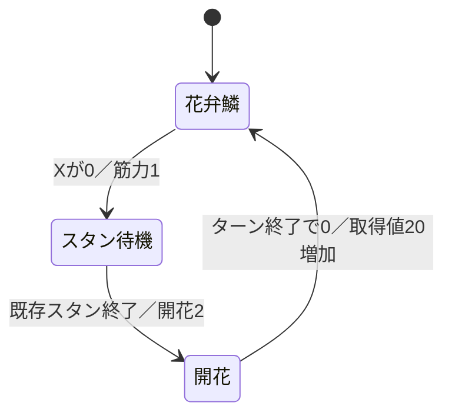

# ASHBOUND ACT6「瘴気の沼」最終仕様書兼設計書

文書版：1.0／作成日：2026年11月13日（日本時間）  
対象：本会話で確定したACT6仕様。ゲームへの実装・公開・実戦テストは本書作成の対象外。

## 1. 目的・適用範囲

毒霧と汚泥に覆われた、沈みゆく集落を舞台とする妨害系ACT。妨害カードの混入と、通常カードへの追加効果によって、予定どおりに動かない手札でも攻防を組み立てる体験を作る。

妨害を処理する手数と、敵を倒して妨害の追加を止める手数を配分する。強敵はHPを低めに設定し、汚染が重なる前に倒し切る攻略を残す。ボスは花弁鱗を破るタイミングと、開花中に受け入れる汚染量を考える戦闘とする。

敵がプレイヤーへ直接毒を付与する行動は採用しない。毒は妨害カード「毒棘」の使用によってのみ発生する。

### 文書の読み方

- 「仕様」は会話で決定した内容と、それを矛盾なく表現するルール。
- 「初期設定」は任された編成・抽選について本書で置く値。実戦調整済みではない。
- 「接続案」「要確認」は現行コードを読んで確定する技術上の細部。既存処理を推測で書き換えない。
- 未採用になった旧仕様は実装しない。特に、開花のダメージによる終了、閉状態の軽減、状態別行動表、HP320、敵からの直接毒付与は廃止済み。

## 2. ACTの構成

| 項目 | 内容 |
|---|---|
| 名称 | ACT6 瘴気の沼 |
| 解放条件案 | ACT5クリア。既存ACTの解放方式へ合わせる |
| 探索構造 | 既存の階層数・報酬・イベント方式を継承 |
| 通常敵 | 泥這い、毒針虫、胞子袋、沼の亡者、霧まとい |
| 強敵 | 根絡みの巨人、腐れ花、霧吐きの獣 |
| ボス | 瘴気の害獣 |
| 新規カード | 戦闘限定の妨害カード6種 |
| 通常報酬プール | 既存の共通基礎・探索者別潜在を維持。妨害カードを混ぜない |

## 3. 妨害カード

分類は全て「妨害」。攻撃・補助・特殊とは別分類にする。

| 内部ID案 | 名前 | コスト | 効果 |
|---|---|---:|---|
| act6_mud | 泥塊 | 0 | 効果なし。除外。 |
| act6_root | 絡み根 | 1 | カードを1枚引く。除外。 |
| act6_thorn | 毒棘 | 0 | 自身に毒3を付与。除外。 |
| act6_miasma | 瘴気 | 使用不可 | ターン終了時、手札にあれば自身に3ダメージ。その後、除外。 |
| act6_spore | 毒胞子 | 0 | 自身に脱力1を付与。除外。 |
| act6_mist | 霧影 | 使用不可 | ターン終了時、手札にあれば除外。 |

内部IDは説明用。既存のID方式に合わせ、新しい未使用IDを割り当てる。既存カードIDは変更しない。

### 共通挙動

- 泥塊・絡み根・毒棘・毒胞子を使わずにターン終了した場合、通常どおり捨て札へ送る。
- 瘴気・霧影の終了時効果は、そのカードが手札にある場合だけ実行する。山札・捨て札にあるものは発動しない。
- 瘴気の3ダメージはブロックで防げる非攻撃ダメージ。HP喪失や毒ダメージではない。
- 瘴気はダメージが全て防がれた場合も除外する。
- 終了時効果は通常の手札破棄より前、使用可能なブロックが残る段階で解決する。
- 複数の瘴気は各1回ずつ処理する。死亡時は既存の敗北処理を優先する。
- 捨てる・除外する効果で先に手札から移動した瘴気は、終了時効果を発生させない。
- 全て戦闘中だけ存在し、戦闘終了で消失する。所持カード、保管庫、基礎デッキを汚染しない。
- 手札への追加時に満杯なら捨て札へ送る。複数枚は1枚ずつ空き枠を判定する。
- 山札に「混ぜる」処理は、加えた後に山札をシャッフルする初期仕様。捨て札追加では山札をシャッフルしない。

### ポーカー・スロット

- 妨害カードの自動使用はポーカーのハンドに記録しない。
- 通常カードの自動使用は従来の記録規則を維持する。フォールド全般を新たに記録対象外にしない。
- 妨害は独立分類なので、通常の攻撃・補助・特殊のスロット一致数には含めない。公開枚数の1枚には数える。
- 妨害カードを通常生成・報酬・役による生成プールへ混ぜない。
- 要確認：手動使用した妨害カードをポーカーへ記録するかは会話で明示決定されていない。自動使用の例外を勝手に全使用へ拡張しない。実装前にこの1点を決める。

## 4. 通常カードへの追加効果

| 内部キー案 | 名前 | 効果 | 解除 |
|---|---|---|---|
| sporeAttached | 胞子付着 | 次の使用コスト+1 | 使用後 |
| mudAttached | 汚泥 | 使用後、捨て札に泥塊1枚を追加 | 使用後 |
| rootBound | 根絡み | このターン、手札から使用できない。自動使用時は効果発動に失敗 | ターン終了時 |

### 付与対象・時点

- 敵行動は「次のプレイヤーターンの付与」を予約する。
- 次ターンの開始ドロー後、操作受付前に予約を処理する。
- 妨害カードと追加効果付きカードを除く手札から、重複なし・等確率でランダム抽選する。
- 対象不足なら可能な枚数だけ付与。不足分を次ターンへ持ち越さない。
- 複数予約は敵の行動解決順で処理し、付与済みの個体は後の予約で対象外にする。
- 付与元を倒した後も、実行済み行動による予約は残る初期接続案。スタンで行動しなかった場合は予約しない。
- 根絡みの巨人について、前回対象と同じ個体は候補が他にあれば避ける。代替候補がなければ付与不発とする初期設定。

### 進化・コピー・自動使用

- 進化・コピーは、その時点で残っている追加効果を引き継ぐ。
- コピー後の状態は独立させる。一方を使用しても、もう一方の追加効果を解除しない。
- 胞子付着・汚泥を使用処理で解除した後に進化する場合、解除済み効果を進化先へ復活させない。
- 胞子付着は既存の支払コスト計算へ+1として接続する。ポーカーの本来コスト自体を書き換えない接続案。
- 無料自動使用のコスト支払いは既存規則を維持し、追加効果だけを理由に新たなエナジー消費を作らない。
- 根絡み付きカードの自動使用は発動失敗。攻撃・防御・ドロー・進化等のカード効果を実行しない。
- 発動失敗時のカード移動先と使用済み扱いは、既存の失敗規則へ接続する。現行に規則がなければ明示決定が必要。新たなポーカー記録を失敗だけで発生させない。
- 汚泥は正常なカード使用後に泥塊を追加する。自動使用でも正常に解決した場合は同じ。
- 全て戦闘終了で解除。カード定義そのものへ変更を保存せず、戦闘中のカード個体へ状態を持たせる。

## 5. 通常敵

各敵は①から始め、最後まで行動すると①へ戻る。ダメージ表記は筋力等の補正前。

| 敵 | HP | ① | ② | ③ |
|---|---:|---|---|---|
| 泥這い | 60 | 8ダメージ、捨て札に泥塊1枚 | 14ブロック | 14ダメージ |
| 毒針虫 | 44 | 山札に毒棘1枚を混ぜる | 4ダメージ×3 | 10ダメージ、自身に筋力1 |
| 胞子袋 | 52 | 捨て札に毒胞子2枚 | 8ダメージ | HP8回復 |
| 沼の亡者 | 58 | 12ダメージ | 次のターン、手札1枚に胞子付着 | 7ダメージ×2 |
| 霧まとい | 46 | 山札に霧影2枚を混ぜる | 6ダメージ×2 | 10ブロック、筋力1 |

毒胞子と瘴気の効果交換後も、敵行動に書かれたカード名は維持する。したがって胞子袋は、使用すると脱力を得る毒胞子を加える敵である。

## 6. 強敵

### 根絡みの巨人：HP100

| 順番 | 行動 |
|---:|---|
| 1 | 12ダメージ。次のターン、手札1枚に根絡み |
| 2 | 26ダメージ |
| 3 | 18ブロック。捨て札に絡み根2枚 |
| 4 | 6ダメージ×3 |

役割：主力1枚が使えない状況での防御・代替手段を問う。低めのHPにより、妨害の反復前に倒す選択肢を残す。

### 腐れ花：HP80

| 順番 | 行動 |
|---:|---|
| 1 | 次のターン、手札2枚に胞子付着 |
| 2 | 8ダメージ。捨て札に毒胞子2枚 |
| 3 | 5ダメージ×3 |
| 4 | HP8回復。以降、②で追加する毒胞子の枚数+1 |

毒胞子の追加枚数は2→3→4…と増加。筋力による成長は行わない。胞子付着の対象枚数は常に2。

**胞子追撃**

> プレイヤーのターン終了時、手札にある毒胞子1枚につき、続く敵ターンの自身の攻撃ダメージが1上昇する。

- 通常の手札破棄前に枚数を確定して記録する。
- 多段攻撃では各ヒットに加算する。
- 例：毒胞子2枚なら、②は10、③は7×3。
- 次のプレイヤーターン終了時に参照値を更新する。永続筋力として蓄積しない。
- 他の敵の攻撃、瘴気の非攻撃ダメージには適用しない。

### 霧吐きの獣：HP110

| 順番 | 行動 |
|---:|---|
| 1 | 山札に霧影3枚を混ぜる。12ブロック |
| 2 | 8ダメージ×2 |
| 3 | 山札に霧影2枚を混ぜる。10ダメージ |
| 4 | 24ダメージ |
| 5 | 筋力1 |

⑤は攻撃・妨害がない立て直しの機会。旧名「沼底の大喰らい」および旧行動表は使用しない。

## 7. ボス「瘴気の害獣」

HP300。旧名「瘴気の主」は使用しない。

### 7.1 行動周期

| 順番 | 行動 |
|---:|---|
| 1 | 2ダメージ×5 |
| 2 | 次のターン、手札2枚に胞子付着。自身に15ブロック |
| 3 | 30ダメージ |
| 4 | 瘴気2枚を捨て札に追加 |
| 5 | 次のターン、手札2枚に根絡み |
| 6 | 20ダメージ |
| 7 | 以降、開花中の攻撃被弾による妨害追加枚数+1 |

①～⑦を繰り返す。花弁鱗・スタン・開花によって別行動表へ切り替えない。状態変化で周期をリセットしない。スタンによる行動順の処理は既存敵と同じにする。

### 7.2 花弁鱗X

表示用説明：

> 受けたダメージ分だけXが減少する。0になると消失し、スタンして筋力1を得る。スタン終了後、開花2を得る。

- 戦闘開始時に花弁鱗50を得る。
- 再取得ごとに取得値+20。50→70→90→110…。
- 減少量はブロックと補正の解決後に実際に減ったHP分とする設計値。
- 攻撃だけでなく毒・裂傷・反撃等のダメージによるHP減少も数える。単純なHP喪失や最大HP変化はダメージと区別する。
- ブロックだけが減ってもXは減らない。
- 0になったら一度だけ筋力1と既存のスタンを付与し、開花待ち状態へ入る。
- 破壊したヒットの超過分は持ち越さない。
- 花弁鱗にダメージ軽減はない。
- 得た筋力は、スタン終了・開花終了後も維持する。

### 7.3 開花X

ダメージ閾値型の旧説明を廃止し、時間制へ更新した表示用説明：

> 受けるダメージが50%上昇する。攻撃ダメージを受けるたび、瘴気・霧影・毒胞子からランダムなカード1枚を、手札・山札・捨て札のいずれかへランダムに加える。ターン終了時にXが1減少し、0になると消失して花弁鱗を得る。

- 花弁鱗を破った瞬間には付与しない。既存のスタンが終了した時点で開花2を付与する。
- スタン中に開花待ちである場合、開花による被ダメージ増加・妨害追加は発生しない。
- 開花は2ターン固定。取得回数によって持続を増やさない。
- 減少点はプレイヤーターン終了時、1ターンにつき1回。敵ターン終了でも二重に減らさない。
- 既存スタン終了点へ接続し、付与直後に不完全なターン分を消費せず、プレイヤーの操作可能な2ターンを確保する。ターン内付与フラグ等で管理する接続案。
- 受けるダメージ+50%は攻撃以外にも適用する。HP喪失とは区別する。
- 脆弱などとの乗算・端数・ブロック適用順は、現行ダメージ基盤の一貫した補正方式へ接続する。既存ACTの計算順は変えない。
- ダメージを受けてもXは減少しない。
- Xが0になった時点で開花を除去し、次回値の花弁鱗を付与する。

### 7.4 開花の妨害追加

- 初期追加枚数は1。行動⑦の実行ごとに+1し、戦闘中維持する。
- 説明文の「1枚」は基礎枚数。⑦による補正値は別の能力数値・説明として常時表示する。
- 攻撃の各ヒットで判定する。5回攻撃なら初期5枚、⑦を1回実行後は10枚。
- ブロックにだけ正の攻撃ダメージが入った場合も発動する。
- ダメージが完全に0なら発動しない接続案。
- 毒・裂傷・棘・茨の盾等の非攻撃ダメージでは発動しない。
- 各カードについて、種類3種と追加先3種をそれぞれ独立・等確率で抽選する。重複あり。
- 手札に空きがなければ、そのカードは捨て札へ送る。抽選をやり直さない。
- 山札への追加は混入処理でシャッフルする。手札や捨て札への追加で山札をシャッフルしない。
- 致死ダメージ時は既存の戦闘終了処理を優先し、終了後に不要な妨害生成を行わない。

### 7.5 状態遷移

スタン待機は開花付与待ちの管理状態で、独自のスタン規則ではない。他のカードで追加されたスタンも含め、既存スタンの終了を確認して一度だけ開花を付与する。花弁鱗と開花を同時に有効にしない。

## 8. 遭遇・抽選の初期設定

| 項目 | 設定 |
|---|---|
| 最初の通常戦闘2回 | 単体 |
| 以降 | 単体30%、2体編成70% |
| 単体抽選 | 5種を等確率、各20% |
| 2体編成 | 5種から異なる2種を選ぶ10組を等確率、各10% |
| 強敵 | 3種のシャッフル袋。一巡まで重複なし |

比率は通常戦闘の編成抽選に対するもので、探索中の戦闘・イベント発生率を変更する値ではない。抽選順・遭遇回数は保存する。数値は委任に基づく初期設定で、実戦テスト後に調整可能。

## 9. UI・表示

- 妨害分類を表示し、通常の報酬カードと混同しない。
- 通常カードの追加効果をアイコンと説明で表示し、胞子付着の追加コストを実支払表示へ反映する。
- 進化先・コピーにも残った追加効果を表示する。
- 根絡みの手動使用不可と自動使用失敗を説明する。
- 瘴気の終了時ダメージ総量と、腐れ花の胞子追撃の現時点の加算見込みを確認できるようにする。
- 腐れ花の毒胞子追加枚数、霧吐きの獣の筋力を予告へ反映する。
- ボスは花弁鱗の残りX、次の取得値、スタンから開花への待機、開花残りターン、ヒットごとの妨害追加枚数を表示する。
- 行動⑦の妨害増加と、花弁鱗破壊時の筋力増加を別々に説明する。
- 既存の表示倍率・カード形状・手札上限・ダメージ表示規則を維持する。

## 10. 実装設計

現行ソース未照合のためファイル名は接続候補。既存のラップ・読込順を確認して最小変更で接続する。

| 対象 | 作業 |
|---|---|
| dist/act6.js（候補） | 敵、遭遇、追加効果予約、ボス状態遷移 |
| カード定義・共通使用処理 | 妨害分類、使用不可、終了時効果、根絡み失敗 |
| 進化・コピー処理 | カード個体の追加効果を引き継ぐ |
| ダメージ処理 | 開花補正、花弁鱗減少、開花の被弾トリガー |
| ターン処理 | 予約付与、胞子追撃の枚数確定、開花減少 |
| スタン終了処理 | 既存スタン終了後の開花付与 |
| 目的地定義 | ACT6登録・解放・選択保持 |
| indexとテスト用読込定義 | 同じスクリプト順を維持 |
| 図鑑・予告 | 新能力・妨害分類・追加効果を表示 |
| パッチノート | 実際の公開時のみ、新しい日本時間の日付で先頭追加 |

### 状態モデル候補

| 保存値 | 用途 |
|---|---|
| card.instanceId / act6Modifier | カード個体の識別と追加効果 |
| run.pendingAct6Modifiers | 次ターン付与の予約一覧 |
| enemy.sporeAddCount | 腐れ花が加える毒胞子枚数、初期2 |
| run.endTurnSporeCount | 手札破棄前の毒胞子枚数 |
| boss.phase | scale / waitingForStunEnd / bloom |
| boss.scaleRemaining | 現在の花弁鱗X |
| boss.scaleAcquisitions | 花弁鱗取得回数。初回1 |
| boss.bloomTurns / bloomGrantedTurn | 開花残り・付与ターン |
| boss.onHitJunkCount | 開花の妨害追加枚数、初期1 |
| encounter.normalCount / eliteBag | 単体導入回数・強敵抽選袋 |

### 処理順の要点

1. ターン開始ドロー完了後、予約済み追加効果を付与する。
2. カード使用可否を先に確認する。根絡みの自動使用は正常解決経路へ入れない。
3. 各攻撃ヒットの開始時点のボス状態を保持し、補正・ブロック・HP減少を解決する。
4. 開始時点が開花なら妨害トリガーを判定。花弁鱗ならHP減少量でXを減らす。
5. 花弁鱗破壊で筋力・スタン・待機へ遷移。後続ヒットは新状態を参照する。
6. プレイヤーの終了処理では、通常の手札破棄前に毒胞子枚数を確定する。瘴気・霧影の終了時処理を行う。
7. 開花を終了時に1減らす。瘴気等と開花減少の相対順は現行終了処理へ合わせて固定し、テストする。
8. 敵ターンでは記録済み枚数を腐れ花の各攻撃ヒットへ適用する。
9. スタン終了通知で、待機中のボスだけに開花2を一度付与する。

同一の使用・被弾・終了イベントを複数のラップで二重処理しない。処理中の勝利・敗北後は残りのイベントを打ち切る。

## 11. 保存・互換性

- 既存project ID `appgprj_6acecd249374819194f77ef99ca6f899`、公開URL、公開範囲を維持する。
- 既存認証、R2 binding `SAVES`、Worker構成、クラウドAPIを維持する。
- `ashbound-v1`、保存形式v=1、クラウド保存キーを変更しない。
- カードIDの振り直し、既存進行・所持品の初期化をしない。
- 妨害札と追加効果は戦闘データだけへ保存。戦闘終了で確実に清掃する。
- コピー・進化した個体、予約、胞子追撃値、ボスの待機状態、開花残り、花弁鱗取得回数、妨害増加量を復元する。
- リロードで抽選のやり直し、筋力の再加算、開花の再付与、瘴気の二重発動が起きないようにする。
- ACT5クリアによる解放を採用する場合、明示的な履歴を使用し、総勝利数から推定しない。
- 公開には最新ソース比較と回帰検証が必要。本依頼は仕様書作成であり、実装・公開は行わない。

## 12. テスト計画・受入条件

### ルールテスト

| 分類 | 検証内容 |
|---|---|
| 妨害カード | 6種のコスト・効果・分類・終了時除外・戦闘後消失 |
| 毒棘 | 直接ダメージでなく毒3付与。未使用時には毒が付かない |
| 瘴気 | ブロックあり／なし、複数枚、事前破棄、手札外で不発 |
| 満杯 | 空き1へ複数追加、満杯時の捨て札送り、再抽選なし |
| 追加効果抽選 | 対象外、重複なし、対象不足、複数予約 |
| 進化・コピー | 残存効果継承、コピー独立、解除済み効果の復活防止 |
| 自動使用 | 根絡み失敗、通常カードのポーカー従来維持、妨害自動使用の記録除外 |
| 腐れ花 | HP80、追加2→3→4、終了時枚数、各ヒット加算、参照値の更新 |
| 他の敵 | HP・全行動周期・筋力獲得順 |
| 花弁鱗 | 初期50、再取得70・90、ブロックのみで減らない、非攻撃HPダメージ、破壊1回処理 |
| スタン待機 | 既存処理との一致、待機中は開花効果なし、終了後に1回だけ開花2 |
| 開花 | ダメージで終了しない、終了時2→1→0、操作可能な2ターン、花弁鱗復帰 |
| 被弾妨害 | 各ヒット、ブロック被弾、非攻撃では不発、⑦で1→2→3、満杯 |
| 保存 | 待機中・開花中・終了処理付近の復元、重複発火防止 |
| 回帰 | 既存ACT、毒・裂傷、フォールド、ポーカー、進化、クラウド保存 |

### バランス確認

未実施。実施時はデッキ・初期HP・遺物・エナジー・試行数・操作方針を明示する。

- 多段・裂傷：スタン中に攻め、開花中に立て直す勝ち筋があるか。
- スロット：妨害分類の混入で成功率と回復力が落ちすぎないか。
- 除外：妨害処理が過度に有利な資源化になっていないか。
- 毒・反撃：開花中の妨害を回避する強みが、他ビルドとの差として過剰でないか。
- 進化：追加コストと根絡みが、初動を止めすぎないか。
- 強敵：HP100／80／110で速攻と準備型の双方が成立するか。
- ボス：花弁鱗50・+20、開花2、⑦の成長が長期戦の事実上の敗北確定になっていないか。

## 13. 実装時の確認事項

最終ゲーム仕様を推測で変えず、以下だけは現行処理との照合または個別決定を行う。

1. 手動使用した妨害カードのポーカーハンド記録。
2. 根絡み自動使用失敗時のカード移動先・使用後解除・関連トリガー。
3. 胞子付着と無料自動使用の優先順。無料化は既存規則を基準にする。
4. スタン終了点と開花の初回減少点の接続。既存スタンを独自仕様へ変えない。
5. 開花+50%の他補正との計算順、端数、完全0ダメージ時のトリガー。

これらは新しい遊びの提案ではなく、同じ仕様を表示・保存・実処理で一致させるための接続事項である。
